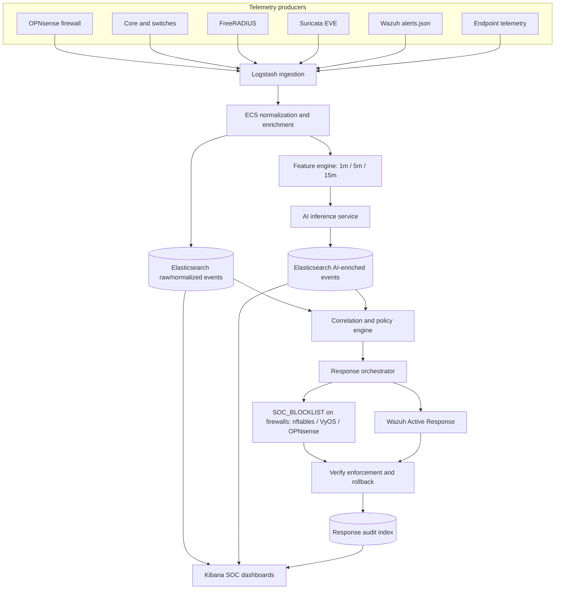

# SOC/AI closed-loop architecture

## Mission

Evolve the repository from network-security IaC with compliance evidence into
an automated SOC and AI-assisted detection-and-response platform. The existing
network remains the source of isolation, realistic telemetry, and controlled
attack scenarios. It is not replaced by the SOC layer.

The operating loop is:

```text
Detect -> Analyze -> Decide -> Respond -> Verify -> Learn
```

The contracts, the Compose and Kubernetes analytics planes, the AI plane (feature
worker, Isolation Forest and LSTM models, governed promotion, mTLS inference, enrichment
worker) and the response plane (signed commands, decision runner, orchestrator service,
nftables/VyOS/OPNsense/Wazuh backends, append-only audit) are implemented in source and
covered by offline tests. None of it may be reported as runtime-validated until the live
gates below have been run on lab hosts: every runtime claim in the compliance report is
`UNVERIFIED` until `make soc-ai-validate` / `make vm-audit` produce evidence.

## Canonical data flow



Elasticsearch and Kibana form the SOC analytics plane. Wazuh Manager remains
the endpoint HIDS, static-rule, FIM, and Active Response engine. Wazuh events
enter the analytics plane from `alerts.json`; Suricata, OPNsense, RADIUS, and
network-device telemetry enter Logstash directly. AI therefore sees normalized
raw events as well as static-rule alerts and is not trained only on events that
Wazuh already selected.

## Trust boundaries

| Zone | Assets | Trust rule |
|---|---|---|
| Telemetry producers | sensors, endpoints, firewalls, AAA, network devices | Events are untrusted input; producers cannot write arbitrary analytics fields. |
| Ingestion | Logstash inputs, parsers, DLQ | Authenticate sources, bound payloads, preserve originals, and route malformed data without stopping a pipeline. |
| Analytics | Elasticsearch and Kibana | TLS only, persistent data, least-privilege service identities, and no direct public Elasticsearch exposure. |
| AI | feature workers, registry, inference API | Models consume versioned feature contracts and return scores; they hold no firewall or endpoint credentials. |
| Decision | correlation and policy engine | An anomaly alone never authorizes containment. A second independent signal is required. |
| Privileged response | orchestrator and adapters | Credentials are scoped per adapter; every create, verify, revert, failure, and expiry becomes an audit event. |
| Analyst | Kibana and approval workflow | Human access is authenticated and cannot bypass response policy or provenance checks. |

The Suricata capture interface has no management address. Management uses a
separate VLAN 99 interface. Routed and mirrored East-West traffic are explicit
inputs to the sensor design; an Internet-uplink mirror alone is insufficient.

## Canonical event and storage contracts

All normalized events conform to `schemas/ecs/soc-event.schema.json`. Required
metadata records the schema version, sensor, zone, VLAN, asset role, dataset,
and ingestion identity. ECS fields such as `source.ip`, `destination.ip`,
`event.category`, `event.dataset`, `network.*`, `host.*`, and `user.*` are used
where applicable.

Logical data streams are separated by purpose:

- `soc-raw-*`: append-only payloads captured before parsing or enrichment;
- `soc-network-*`, `soc-endpoint-*`, `soc-auth-*`, `soc-alerts-*`: normalized telemetry;
- `soc-features-*`: reproducible window features;
- `soc-ai-*`: scores, thresholds, model identity, and inference latency;
- `soc-response-*`: decisions, enforcement verification, expiry, and rollback;
- `soc-deadletter-*`: rejected input with parser error metadata and original payload.

The feature contract is versioned independently from the event contract.
Dataset, feature-schema, model, Git revision, random seed, hyperparameters,
threshold, and train/test windows are hashed or recorded before a model may be
promoted.

## Analyst views and evidence boundaries

Version-controlled Kibana objects provide four read-only views:

| Dashboard | Data view | Evidence it is designed to expose |
|---|---|---|
| SOC Overview | normalized telemetry | Cross-source Suricata, Wazuh, firewall, and RADIUS telemetry |
| Network / NIDS | normalized telemetry | Flows, zones, firewall outcomes, and IDS alerts |
| AI | `soc-ai-*` | Model ID, feature schema, score, threshold, anomaly result, and latency |
| Response | `soc-response-*` | Decision, application, verification, expiry, and rollback lifecycle |

Raw records (`soc-raw-*`) and parser failures (`soc-deadletter-*`) have
separate data views. They are not part of the ordinary analyst dashboards, and
saved searches avoid showing `event.original`. Access to those records must be
restricted by Kibana roles because source payload may contain sensitive
operational content even though secrets must never intentionally be logged.

Kibana does not contain adapter credentials or actionable response controls.
The AI dashboard shows inference evidence only; it cannot become an
AI-to-firewall shortcut. A Response dashboard row is created only after the
correlation, decision, orchestrator, and verification chain produces an
append-only `soc-response-*` audit event.

## Detection and response invariant

The MVP decision policy is fail-closed:

```text
score < 0.75                  -> store only
0.75 <= score < 0.90         -> alert an analyst
score >= 0.90 + second signal -> eligible for automatic response
```

Valid second signals include a Suricata alert, high-severity Wazuh alert,
repeated authentication failures, threat-intelligence match, or known
protected-asset context. Eligibility still requires an allowlist check, TTL,
rate limit, deduplication, rollback plan, and append-only response audit.

Network containment is membership of the fixed `SOC_BLOCKLIST` set on *every* firewall peer
(nftables in Path A/C, VyOS in Path B, an OPNsense alias where one exists); the orchestrator
applies and independently verifies every peer before reporting success, and a revert never
removes an entry the response plane did not add (ownership ledger). Endpoint containment uses a
controlled Wazuh Active Response adapter verified through a FIM marker.
AI services cannot call either
adapter directly and cannot execute arbitrary shell commands. The command handoff is
authenticated with Ed25519: only the decision runner can sign.

## Scientific evaluation

The detector order is static rules, Isolation Forest, static plus Isolation
Forest, LSTM autoencoder, then static plus LSTM. Dataset splits are temporal,
not random by event. Required comparison metrics are Precision, Recall, F1,
PR-AUC, false positives per hour, MTTD, containment/response time, event rate,
p95 inference latency, CPU, and RAM. Accuracy is not a primary metric for the
imbalanced anomaly dataset.

## Delivery gates

Source status is "implemented and tested offline"; *live* status is "evidence exists from a lab run"
and is `UNVERIFIED` for every row until `make soc-smoke`, `make soc-ai-validate`, `make vm-audit` and
`make k8s-smoke` have been run on lab hosts.

| Gate | Source | Live evidence |
|---|---|---|
| 1. Ingestion: each required source produces a real Elasticsearch event the SOC dashboard reads | implemented (`soc/logstash`, normalization schema) | LOG-01..03, SOC-01 |
| 2. AI baseline: reproducible features drive inference; scores return to Elasticsearch; no automatic block | implemented (feature/enrichment workers, API, both model families) | AI-01..03 |
| 3. Evaluation: leakage-safe temporal split; benchmark tables regenerate | implemented (dataset builder, artifact-bound evaluation, five-detector comparison, governed promotion) | AI-04 (needs a real captured dataset; none ships) |
| 4. Response: correlation-gated create/verify/revert with TTL, allowlist, rate limit, audit | implemented (decision runner, orchestrator service, three firewall backends, Wazuh isolation) | COR-01, RESP-01..03, SOC-02..03 |
| 5. Network fidelity: OPNsense HA, Core L3/SPAN, VLAN 30/40/50/99, AAA visibility | **not implemented**: the lab fabric is nftables (Path A) and VyOS (Path B); the OPNsense backend is contract-tested only | RESP-04 stays *planned* |
| 6. Audit-grade release: provenance, loss/DLQ, latency, HA, adversarial and false-positive experiments | provenance, DLQ and timing verifiers exist; adversarial/false-positive experiments do not | partial |

`compliance/controls.yaml` lists every runtime control above as an evidence-backed control with an
executable verifier on each profile that physically contains its subject (RESP-02, endpoint isolation,
exists only in Path B, so Path A reports it "not applicable" rather than passed). `planned_controls`
holds only what no lab path can verify yet (RESP-04). A source configuration alone is never a PASS claim.

## Residual risks and limits

- No model is trained on real telemetry in this repository; synthetic-data metrics are test artifacts.
- The live verifiers inject the anomaly that feeds the COR/RESP scenario (the model path is AI-01), and LOG-01
  uses operator fixtures, so it proves pipeline mapping per source, not production transport authenticity.
- VyOS has no per-element timeout, so on Path B expiry rests on the orchestrator's TTL sweep (nftables also has a
  firewall-side backstop). Wazuh FIM reporting lags the isolation by seconds.
- In Path C the Wazuh API certificate carries the Compose host name, so endpoint isolation fails closed until the PKI
  is reissued; image builds, the VyOS/Wazuh API contracts and the Kubernetes runtime have not been exercised here.
